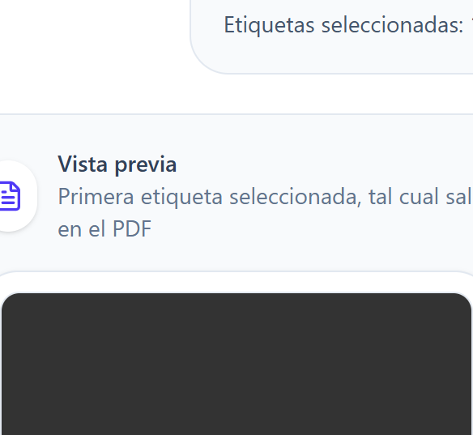
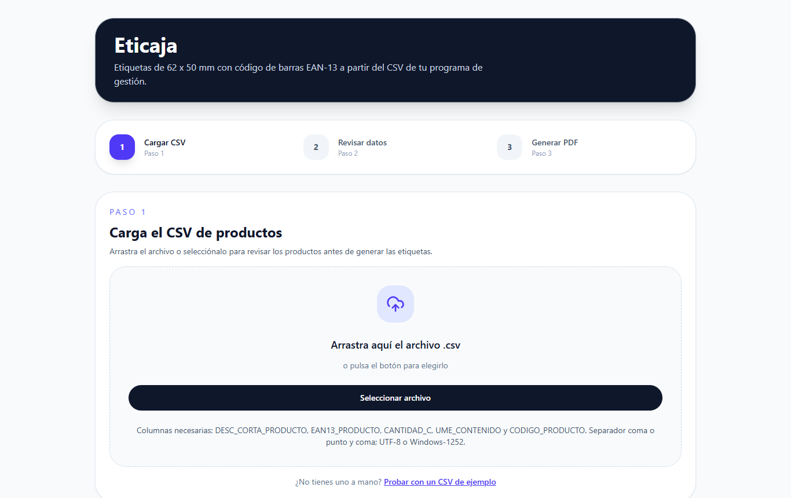
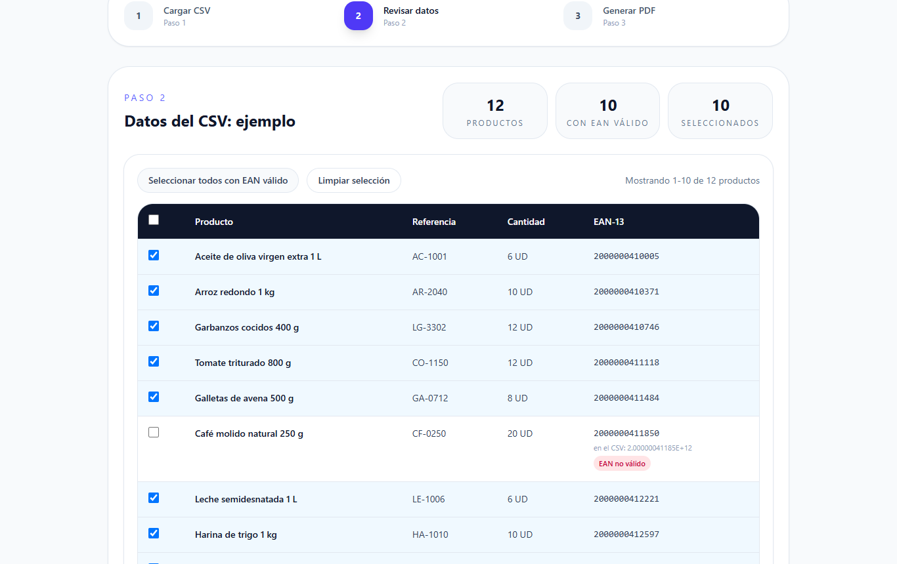
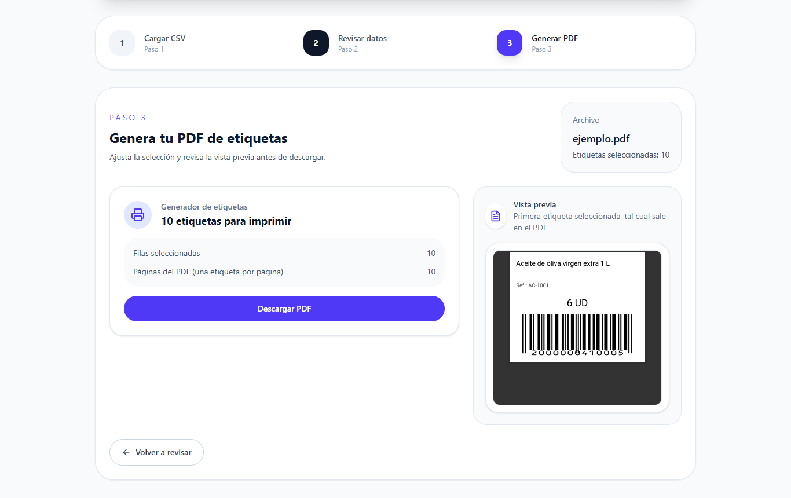
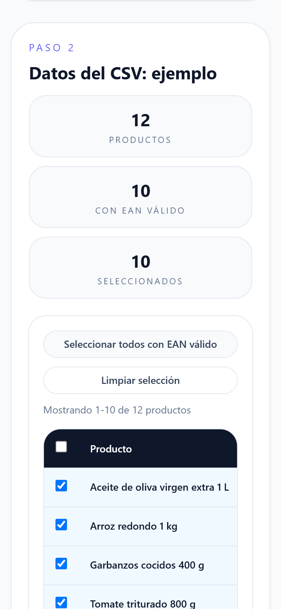
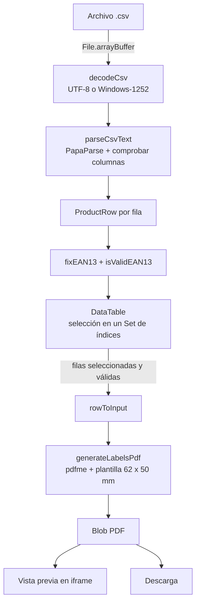

<div align="center">
  <h1>Eticaja</h1>
  <p>Etiquetas de 62 x 50 mm con código de barras EAN-13 a partir del CSV de un programa de gestión. Funciona entera en el navegador.</p>

  <p>
    
    
    
    
    
  </p>
  <p>
    <a href="https://dasikuhp.github.io/eticaja-app/"><strong>Probar la demo</strong></a> ·
    <a href="https://github.com/DasikuHp/eticaja-app/actions/workflows/ci.yml"></a>
    
  </p>
</div>

La hice para dejar de pagar un programa de etiquetas. El programa de gestión exporta los productos a un CSV; Eticaja lo lee, enseña qué filas tienen un código de barras correcto, deja elegir cuáles imprimir y genera un PDF con una etiqueta por página, listo para una impresora de etiquetas de 62 x 50 mm. El CSV no sale del navegador: no hay servidor.

<div align="center">
  
  <p><sub>Una etiqueta del PDF, generada con el CSV de ejemplo (productos ficticios).</sub></p>
</div>

## Cómo se usa

Son tres pasos. En la [demo](https://dasikuhp.github.io/eticaja-app/) se puede probar con el botón "Probar con un CSV de ejemplo".

| 1. Cargar el CSV | 2. Revisar | 3. Generar |
| :---: | :---: | :---: |
|  |  |  |
| Se arrastra el archivo o se elige. Si faltan columnas, dice cuáles. | La tabla marca los EAN que no son válidos y enseña el valor original cuando lo ha corregido. Por defecto solo quedan seleccionadas las filas que se pueden imprimir. | La vista previa es el PDF real de la primera etiqueta. Al descargar, se omiten las filas sin EAN válido y se avisa de cuántas. |

El CSV necesita estas columnas (los nombres son los que exporta el programa de gestión):

| Columna | En la etiqueta |
| :--- | :--- |
| `DESC_CORTA_PRODUCTO` | Nombre del producto (la letra se reduce si no cabe) |
| `CODIGO_PRODUCTO` | "Ref.: ..." |
| `CANTIDAD_C` y `UME_CONTENIDO` | Cantidad y unidad, en grande |
| `EAN13_PRODUCTO` | Código de barras EAN-13 |

También se puede usar desde el móvil, aunque la tabla obliga a desplazarse en horizontal:

<div align="center">
  
</div>

## Stack

| Parte | Tecnologías |
| :--- | :--- |
| Interfaz | React 19, TypeScript, Tailwind CSS 4, `lucide-react` |
| Tabla | TanStack Table (selección y paginación) |
| CSV | PapaParse y `TextDecoder` (UTF-8 o Windows-1252) |
| PDF y código de barras | pdfme 6 (`@pdfme/generator`, `@pdfme/schemas`) |
| Build, tests y despliegue | Vite 8, Vitest, ESLint, GitHub Actions y GitHub Pages |

## Cómo funciona por dentro



Todo el código que no es interfaz está en `src/lib/`, separado de React para poder probarlo:

- `csv-utils.ts` lee el fichero. Primero intenta decodificarlo como UTF-8 con `TextDecoder('utf-8', { fatal: true })`; si encuentra bytes que no son UTF-8 (lo normal cuando el CSV se ha guardado con Excel en español) lo vuelve a leer como Windows-1252, y así las tildes y la ñ salen bien. PapaParse detecta si el separador es coma o punto y coma.
- Excel estropea los códigos de barras al abrir el CSV: los convierte en números como `8.41234E+12` o `8412345678905.0`. `fixEAN13()` deshace esos cambios, aunque si Excel ya ha redondeado el número los dígitos perdidos no se pueden recuperar.
- `isValidEAN13()` comprueba el dígito de control: se suman los 12 primeros dígitos multiplicando uno sí y uno no por 3, y el último dígito tiene que ser lo que falta para llegar a la siguiente decena. Esto importa porque el generador de códigos de barras lanza un error con un EAN incorrecto, y un solo error pararía todo el PDF.
- `label-template.ts` define la etiqueta como una plantilla de pdfme: una página de 62 x 50 mm con cuatro campos (nombre, referencia, cantidad y código de barras) colocados en milímetros. `generateLabelsPdf()` recibe una lista de etiquetas y devuelve el PDF con una página por cada una.

En la interfaz, `App.tsx` guarda el paso actual (cargar, revisar o generar), las filas y la selección. La selección es un `Set` con los índices de las filas marcadas. La vista previa (`LabelPreview.tsx`) llama a la misma función que la descarga, pero con una sola etiqueta, y muestra el PDF en un `iframe`; por eso lo que se ve es lo que se imprime. pdfme y el generador de códigos de barras pesan más de 1 MB, así que se cargan con `import()` solo cuando hacen falta.

## Estructura

```text
eticaja-app
├── public/ejemplo.csv            12 productos ficticios (2 con EAN incorrecto a propósito)
├── src/
│   ├── App.tsx                   Pasos, estado y avisos
│   ├── components/
│   │   ├── CsvDropzone.tsx       Arrastrar o elegir el CSV
│   │   ├── DataTable.tsx         Tabla con selección y paginación
│   │   ├── LabelPreview.tsx      Vista previa con el PDF real
│   │   └── PdfGenerator.tsx      Resumen y descarga
│   └── lib/
│       ├── csv-utils.ts          Lectura del CSV y validación del EAN-13
│       ├── csv-utils.test.ts     Tests con Vitest
│       └── label-template.ts     Plantilla de pdfme y generación del PDF
├── .github/workflows/ci.yml      Lint, tests, build y despliegue en Pages
└── docs/media/                   Capturas de este README
```

## Instalación

```bash
git clone https://github.com/DasikuHp/eticaja-app.git
cd eticaja-app
npm install
npm run dev        # http://localhost:5173
```

| Script | Qué hace |
| :--- | :--- |
| `npm run dev` | Servidor de desarrollo de Vite |
| `npm test` | Tests con Vitest |
| `npm run lint` | ESLint |
| `npm run build` | Comprueba los tipos y genera `dist/` |

Cada push a `main` pasa el lint, los tests y el build en GitHub Actions y publica `dist/` en GitHub Pages.

## Tests

Los 8 tests de `src/lib/csv-utils.test.ts` comprueban el dígito de control del EAN-13, que se arreglan los EAN estropeados por Excel, que se lee el CSV de ejemplo, que se avisa si faltan columnas, que un CSV en Windows-1252 se lee bien, y que el PDF generado tiene una página de 62 x 50 mm por etiqueta.

## Limitaciones

- La etiqueta tiene un diseño fijo de 62 x 50 mm; para cambiarlo hay que editar `label-template.ts`.
- Los nombres de las columnas son los de un programa de gestión concreto.
- Si Excel ya ha convertido un EAN a notación científica y ha perdido dígitos, no se puede recuperar: la fila sale marcada como no válida.
- El texto usa la fuente por defecto de pdfme, sin negrita.

## Licencia

[Business Source License 1.1](LICENSE). Puedes leer, copiar y modificar el código y usarlo fuera de producción. El uso comercial necesita permiso; el 7 de mayo de 2030 pasa a Apache 2.0. Contacto: [dasikuhp@gmail.com](mailto:dasikuhp@gmail.com).

<div align="center">
  <sub>Hecho por <a href="https://github.com/DasikuHp">DasikuHp</a> · versión 1.0.0</sub>
</div>
